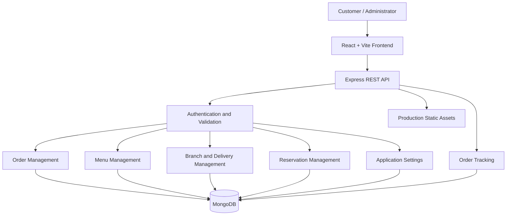
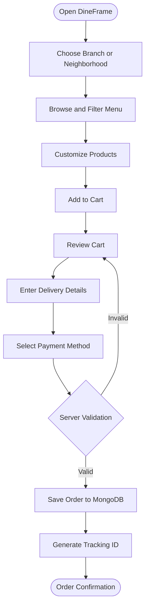
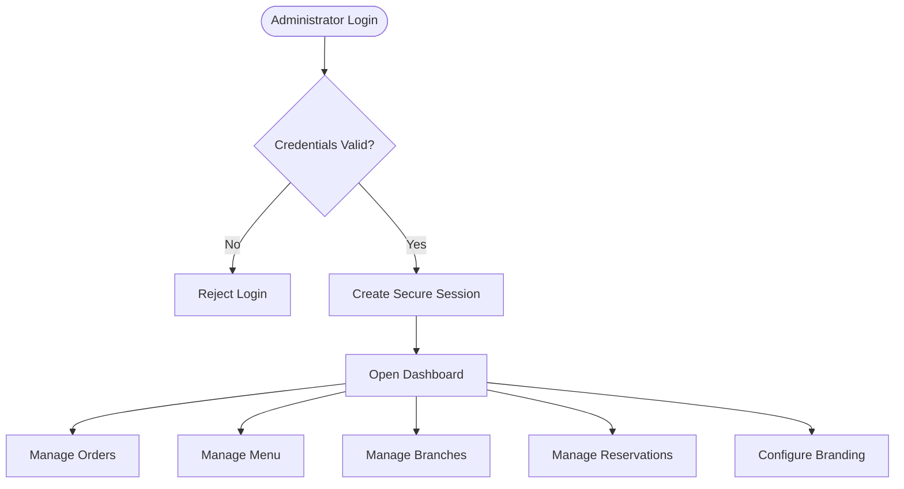
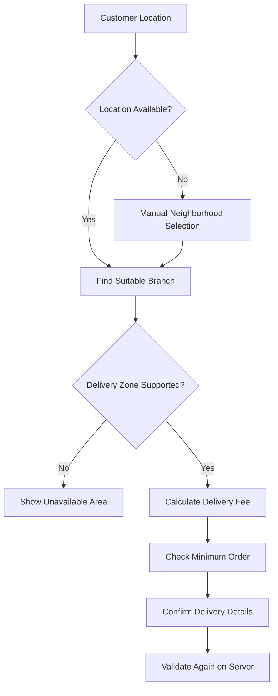
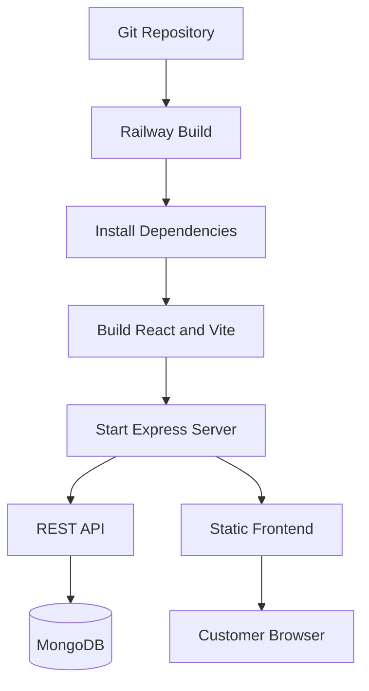

# 🍽️ DineFrame

<p align="center">
  <strong>Discover. Order. Track. Manage.</strong>
  <br />
  A modern restaurant ordering and management platform built to deliver seamless dining experiences and smarter restaurant operations.
</p>

<p align="center">
  
  
  
  
  
</p>

<p align="center">
  
  
  
</p>

---

## 📖 Table of Contents

- [🌟 Overview](#-overview)
- [✨ Key Features](#-key-features)
- [🖥️ Technology Stack](#️-technology-stack)
- [🏗️ System Architecture](#️-system-architecture)
- [🔄 Application Workflows](#-application-workflows)
- [📂 Project Structure](#-project-structure)
- [⚙️ Getting Started](#️-getting-started)
- [🔐 Environment Configuration](#-environment-configuration)
- [📜 Available Commands](#-available-commands)
- [🔌 API Documentation](#-api-documentation)
- [🗄️ Database Design](#️-database-design)
- [🛒 Ordering and Pricing Logic](#-ordering-and-pricing-logic)
- [📍 Branch and Delivery Management](#-branch-and-delivery-management)
- [💳 Payment Methods](#-payment-methods)
- [🛡️ Security](#️-security)
- [🚀 Railway Deployment](#-railway-deployment)
- [🧪 Testing and Quality Assurance](#-testing-and-quality-assurance)
- [❓ Frequently Asked Questions](#-frequently-asked-questions)
- [🗺️ Roadmap](#️-roadmap)
- [🤝 Contributing](#-contributing)
- [📄 License](#-license)

---

## 🌟 Overview

**DineFrame** is a full-stack restaurant ordering and management platform designed to connect customers, restaurant operations, and administrators through a unified digital experience.

The platform combines an interactive food ordering storefront with branch-aware delivery management, customizable menu items, guest checkout, order tracking, table reservations, and an administration dashboard.

Built with React, Vite, TypeScript, Express, and MongoDB, DineFrame is designed to support responsive customer experiences and centralized restaurant operations.

### 🎯 Project Goals

- Create a premium, intuitive online food ordering experience.
- Make restaurant menus searchable, filterable, and customizable.
- Automatically identify suitable delivery branches.
- Calculate delivery charges and minimum order requirements.
- Allow customers to place orders without mandatory registration.
- Provide unique order tracking identifiers.
- Centralize order, menu, branch, and reservation management.
- Support brand and theme customization for agency workflows.
- Deploy the frontend and backend through a unified Node.js application.

### 👥 Target Users

| User | Capabilities |
|---|---|
| Customers | Discover food, customize dishes, order, and track deliveries |
| Restaurant Administrators | Manage orders, menus, reservations, branches, and settings |
| Kitchen Teams | Review accepted orders and manage preparation progress |
| Dispatch Teams | Coordinate delivery and update dispatch information |
| Agencies | Customize supported branding and restaurant configurations |

---

## ✨ Key Features

<details open>
<summary><strong>🍔 1. Customer Discovery and Menu Experience</strong></summary>

### Hero Spotlight Carousel

An editorial-style carousel highlights signature dishes, promotional offers, and family meal combinations.

Features:

- Automatic slide transitions.
- Pause-on-hover behavior.
- Keyboard navigation.
- Responsive layouts.
- Featured product links.
- Promotional messaging.
- High-quality food imagery.

### Smart Menu Discovery

Customers can explore the restaurant's digital menu using:

- Instant search by dish name.
- Description and ingredient matching.
- Category-based navigation.
- Price sorting.
- Alphabetical sorting.
- Dietary and promotional tags.
- Spice-level filters.
- Availability indicators.

### Supported Tags

| Tag | Purpose |
|---|---|
| Halal | Identifies menu items marked as halal |
| Bestseller | Highlights popular dishes |
| Chef's Special | Highlights selected signature items |
| Vegetarian | Identifies vegetarian options |
| Mild | Indicates a mild spice level |
| Medium | Indicates a medium spice level |
| Fiery | Indicates a high spice level |

### Product Customization

Customers can customize menu items before adding them to the cart.

- Select portion sizes, such as Half KG and Full KG.
- Add optional accompaniments.
- Choose extra ingredients or add-ons.
- Change quantities.
- Add preparation instructions.
- View updated prices as options change.

The server must validate the selected options and calculate the authoritative price when an order is submitted.

</details>

<details>
<summary><strong>📍 2. Smart Geolocation and Branch Selection</strong></summary>

DineFrame is designed to select an appropriate restaurant branch based on customer location and configured delivery zones.

Features:

- Browser-based geolocation with permission.
- Manual neighborhood selection.
- Nearest-branch calculation.
- Delivery serviceability validation.
- Branch-specific delivery fees.
- Minimum order requirements.
- Neighborhood-to-kitchen routing.
- Clear feedback for unsupported delivery areas.

### Branch Selection Workflow

1. The customer shares their location or selects a neighborhood.
2. The application identifies suitable branches.
3. The delivery zone is checked against branch configuration.
4. The applicable delivery fee and minimum order are determined.
5. The customer confirms the branch and delivery address.
6. The backend validates the selected branch again during checkout.

Location access should remain optional, with manual selection available as a fallback.

</details>

<details>
<summary><strong>🛒 3. Shopping Cart and Checkout</strong></summary>

### Shopping Cart

- Add and remove products.
- Increase or decrease quantities.
- Update product customizations.
- Display item-level pricing.
- Calculate the subtotal.
- Apply the selected branch's delivery fee.
- Display the final payable amount.
- Include customer instructions.
- Validate minimum order requirements.

### Guest Checkout

Customers can place orders without creating an account.

Checkout information may include:

- Customer name.
- Contact number.
- Delivery address.
- Selected neighborhood.
- Selected restaurant branch.
- Order notes.
- Payment method.
- Itemized order summary.

### Payment Options

- Cash on Delivery (COD).
- Card on Delivery.
- Raast / Bank Transfer.

Payment confirmation and automated transaction verification require appropriate integrations or an implemented verification process.

</details>

<details>
<summary><strong>🚚 4. Order Tracking</strong></summary>

Every successfully created order receives a unique tracking identifier.

Example:

`DF-2026-9041`

### Five-Stage Order Pipeline

| Stage | Status | Description |
|---|---|---|
| 1 | `pending` | Order received and awaiting confirmation |
| 2 | `confirmed` | Restaurant accepts the order |
| 3 | `preparing` | Kitchen prepares the food |
| 4 | `out_for_delivery` | Order has been dispatched |
| 5 | `completed` | Delivery is completed |

Customers can view the current order status and relevant order details through a tracking interface.

The tracking interface should retrieve the latest status from the backend. Actual real-time updates require polling, server-sent events, WebSockets, or another implemented synchronization mechanism.

</details>

<details>
<summary><strong>🪑 5. Reservations and Additional Pages</strong></summary>

### Table Reservations

Customers can submit reservation requests with:

- Name and contact number.
- Preferred branch.
- Reservation date.
- Preferred time.
- Party size.
- Special requests.

Administrators can review requests and update reservation statuses.

Availability checking and prevention of conflicting reservations should be implemented on the backend.

### Additional Pages

- **About Us:** Restaurant story, values, and food philosophy.
- **Interactive Gallery:** Food photography and restaurant visuals.
- **Branch Directory:** Branch addresses, operating hours, and contact details.
- **Contact Us:** Customer inquiries and support information.
- **WhatsApp Support:** Direct communication using the configured business number.
- **Frequently Asked Questions:** Answers to common customer questions.

</details>

<details>
<summary><strong>📊 6. Administration Dashboard</strong></summary>

### Metrics Overview

The administration dashboard can display:

- Gross revenue in PKR.
- Total orders.
- Pending orders.
- Active orders.
- Completed orders.
- Reservation metrics.
- Operational summaries.

Revenue figures should use defined financial rules for completed orders, cancellations, refunds, and unpaid transfers.

### Order Management

Administrators can:

- Review incoming orders.
- Confirm or reject orders.
- Update order statuses.
- Add dispatch notes.
- View customer and delivery details.
- Review selected payment methods.
- Print order receipts.
- Filter orders by status.

### Menu Management

- Create, update, and delete menu items.
- Edit product descriptions and prices.
- Assign product images.
- Manage ingredients and portion sizes.
- Configure optional extras.
- Assign dietary tags.
- Set spice levels.
- Organize menu categories.
- Toggle stock availability.

### Branch Management

- Create and update branch records.
- Configure addresses and contact details.
- Set operating hours.
- Configure delivery fees.
- Set minimum order values.
- Manage delivery neighborhoods.
- Define branch routing rules.

### Reservation Management

- View incoming reservation requests.
- Review reservation details.
- Approve or reject requests.
- Update reservation statuses.
- Manage special requests.

</details>

<details>
<summary><strong>🎨 7. Agency White-Label Customization</strong></summary>

DineFrame includes a white-label customization concept for adapting the storefront to different restaurant brands.

Supported configuration may include:

- Restaurant name.
- Logo and brand assets.
- Currency label.
- Contact number.
- WhatsApp number.
- Primary theme color.
- Hover and accent colors.
- Background colors.
- Live theme preview.

For multiple independent restaurant clients, additional tenant isolation, authorization, and data separation are required. Changing branding alone does not establish a secure multi-tenant system.

</details>

---

## 🖥️ Technology Stack

| Technology | Purpose |
|---|---|
| React | Frontend component architecture |
| Vite | Development server and production bundler |
| TypeScript | Type safety and maintainability |
| Node.js | Server-side JavaScript runtime |
| Express | Backend REST API and static asset hosting |
| MongoDB | Persistent data storage |
| REST API | Client-server communication |
| HTTP Cookies | Administrative session handling |
| Railway | Production deployment |

Additional dependencies should be documented according to the packages actually installed in the repository.

---

## 🏗️ System Architecture

DineFrame follows a client-server architecture.



### Frontend Responsibilities

- Render customer-facing pages.
- Display menus and product options.
- Manage temporary cart state.
- Provide search, filtering, and sorting.
- Collect checkout information.
- Display tracking information.
- Render administrative interfaces.
- Communicate with backend endpoints.

### Backend Responsibilities

- Handle API requests.
- Validate incoming data.
- Authenticate administrators.
- Authorize protected operations.
- Calculate order totals.
- Enforce delivery rules.
- Manage order transitions.
- Persist records in MongoDB.
- Initialize seed data when appropriate.
- Serve production frontend assets.

### Source of Truth

The frontend may maintain a temporary cache for responsive interactions. However, the backend remains authoritative for prices, product availability, permissions, delivery fees, and final order totals.

---

## 🔄 Application Workflows

### Customer Ordering Workflow



### Administrative Workflow



---

## 📂 Project Structure

The following is a representative structure. Actual filenames may differ.

```text
DineFrame/
├── public/
│   └── static-assets/
│
├── src/
│   ├── components/
│   │   ├── common/
│   │   ├── layout/
│   │   ├── menu/
│   │   ├── cart/
│   │   └── admin/
│   │
│   ├── pages/
│   │   ├── Home.tsx
│   │   ├── Menu.tsx
│   │   ├── Checkout.tsx
│   │   ├── TrackOrder.tsx
│   │   ├── Reservations.tsx
│   │   ├── About.tsx
│   │   ├── Gallery.tsx
│   │   ├── Branches.tsx
│   │   ├── Contact.tsx
│   │   └── Admin/
│   │
│   ├── data/
│   │   └── initialData.ts
│   │
│   ├── hooks/
│   ├── services/
│   ├── types/
│   ├── utils/
│   ├── App.tsx
│   └── main.tsx
│
├── server/
│   ├── index.ts
│   ├── routes/
│   ├── middleware/
│   ├── services/
│   ├── models/
│   └── utils/
│
├── .env.example
├── .gitignore
├── index.html
├── package.json
├── package-lock.json
├── tsconfig.json
├── vite.config.ts
└── README.md
```

---

## ⚙️ Getting Started

### Prerequisites

Before installing DineFrame, ensure you have:

- Node.js compatible with the project's dependencies.
- npm.
- A MongoDB instance, local or hosted.
- Git, if cloning the repository.
- A modern web browser.

<details>
<summary><strong>Step 1 — Clone the repository</strong></summary>

```bash
git clone <YOUR_REPOSITORY_URL>
cd DineFrame
```

Replace `<YOUR_REPOSITORY_URL>` with the actual repository URL.

</details>

<details>
<summary><strong>Step 2 — Install dependencies</strong></summary>

```bash
npm install
```

</details>

<details>
<summary><strong>Step 3 — Configure environment variables</strong></summary>

Create a `.env` file in the project root.

See [Environment Configuration](#-environment-configuration).

</details>

<details>
<summary><strong>Step 4 — Configure MongoDB</strong></summary>

For local development, a connection string may look like:

```env
MONGODB_URI=mongodb://127.0.0.1:27017/dineframe
```

For hosted MongoDB, use the connection string supplied by your database provider.

Ensure the server has permission to connect to the database.

</details>

<details>
<summary><strong>Step 5 — Start the development environment</strong></summary>

```bash
npm run dev
```

The development command may start the frontend alone or run multiple services, depending on `package.json`.

</details>

<details>
<summary><strong>Step 6 — Build and start production</strong></summary>

```bash
npm run build
npm start
```

Ensure that both commands are defined correctly in the project scripts.

</details>

---

## 🔐 Environment Configuration

Example `.env` file:

```env
NODE_ENV=development
PORT=3000

MONGODB_URI=mongodb://127.0.0.1:27017/dineframe

SESSION_SECRET=replace_with_a_long_random_secret

CLIENT_URL=http://localhost:5173
```

### Environment Variables

| Variable | Description |
|---|---|
| `NODE_ENV` | Development or production environment |
| `PORT` | Express server port |
| `MONGODB_URI` | MongoDB connection string |
| `SESSION_SECRET` | Secret used to sign or protect sessions |
| `CLIENT_URL` | Frontend origin, if required |

**Important:** These are example variable names. Confirm that they match the names read by the application.

### Security Rules

- Never commit real secrets.
- Store production secrets in Railway environment settings.
- Do not expose private backend credentials through Vite environment variables.
- Use a strong, randomly generated session secret.
- Keep `.env` in `.gitignore`.
- Use placeholder values in `.env.example`.

---

## 📜 Available Commands

| Command | Purpose |
|---|---|
| `npm install` | Install dependencies |
| `npm run dev` | Start development |
| `npm run build` | Build production assets |
| `npm start` | Start the production server |
| `npm run preview` | Preview the production build, if configured |
| `npm run lint` | Run linting, if configured |
| `npm test` | Run tests, if configured |

The available scripts depend on the actual `package.json`.

---

## 🔌 API Documentation

The following table documents a suggested REST API design. Treat the paths as proposed conventions until verified against the implementation.

### Menu and Categories

| Method | Endpoint | Description |
|---|---|---|
| `GET` | `/api/menu` | Retrieve menu items |
| `GET` | `/api/categories` | Retrieve categories |
| `GET` | `/api/menu/:id` | Retrieve one menu item |

### Branches and Delivery

| Method | Endpoint | Description |
|---|---|---|
| `GET` | `/api/branches` | Retrieve active branches |
| `GET` | `/api/branches/:id` | Retrieve branch details |
| `POST` | `/api/delivery/check` | Check serviceability and delivery rules |

### Orders and Tracking

| Method | Endpoint | Description |
|---|---|---|
| `POST` | `/api/orders` | Create a validated order |
| `GET` | `/api/orders/track/:trackingId` | Retrieve permitted tracking details |
| `GET` | `/api/admin/orders` | Retrieve orders for administrators |
| `PATCH` | `/api/admin/orders/:id/status` | Update an order status |

### Reservations

| Method | Endpoint | Description |
|---|---|---|
| `POST` | `/api/reservations` | Submit a reservation |
| `GET` | `/api/admin/reservations` | Retrieve reservations |
| `PATCH` | `/api/admin/reservations/:id` | Update a reservation |

### Administration

| Method | Endpoint | Description |
|---|---|---|
| `POST` | `/api/admin/login` | Authenticate an administrator |
| `POST` | `/api/admin/logout` | End the current session |
| `GET` | `/api/admin/session` | Retrieve session information |
| `POST` | `/api/admin/menu` | Create a menu item |
| `PATCH` | `/api/admin/menu/:id` | Update a menu item |
| `DELETE` | `/api/admin/menu/:id` | Delete a menu item |
| `GET` | `/api/settings` | Retrieve public storefront settings |

### API Guidelines

- Validate request bodies on the server.
- Enforce authorization on all administrative operations.
- Return appropriate HTTP status codes.
- Keep error messages useful without exposing internal details.
- Validate prices and availability against database records.
- Avoid exposing unnecessary customer information.
- Apply rate limiting to sensitive endpoints.

---

## 🗄️ Database Design

MongoDB stores the application's persistent data.

The following collections describe a recommended logical schema.

<details>
<summary><strong>📦 Menu Items</strong></summary>

Suggested fields:

- `_id`
- `name`
- `description`
- `ingredients`
- `categoryId`
- `image`
- `tags`
- `spiceLevel`
- `variants`
- `extras`
- `isAvailable`
- `createdAt`
- `updatedAt`

</details>

<details>
<summary><strong>📂 Categories</strong></summary>

Suggested fields:

- `_id`
- `name`
- `description`
- `image`
- `sortOrder`
- `isActive`

</details>

<details>
<summary><strong>📍 Branches</strong></summary>

Suggested fields:

- `_id`
- `name`
- `address`
- `coordinates`
- `contactNumber`
- `operatingHours`
- `deliveryFee`
- `minimumOrder`
- `deliveryZones`
- `isActive`

</details>

<details>
<summary><strong>🛒 Orders</strong></summary>

Suggested fields:

- `_id`
- `trackingId`
- `customer`
- `branchId`
- `items`
- `subtotal`
- `deliveryFee`
- `total`
- `paymentMethod`
- `paymentStatus`
- `orderStatus`
- `deliveryAddress`
- `customerNotes`
- `dispatchNotes`
- `createdAt`
- `updatedAt`

Store a snapshot of each purchased item's name, selected options, quantity, and price so that future menu changes do not alter historical order details.

</details>

<details>
<summary><strong>🪑 Reservations</strong></summary>

Suggested fields:

- `_id`
- `customerName`
- `contactNumber`
- `branchId`
- `reservationDate`
- `reservationTime`
- `partySize`
- `specialRequests`
- `status`
- `createdAt`

</details>

<details>
<summary><strong>⚙️ Application Settings</strong></summary>

Suggested fields:

- `_id`
- `brandName`
- `logo`
- `currency`
- `contactNumber`
- `whatsappNumber`
- `theme`
- `updatedAt`

</details>

### Database Seeding

The initial seed data is intended to come from:

`src/data/initialData.ts`

The initialization workflow should:

1. Connect to MongoDB.
2. Check whether relevant collections are empty.
3. Seed empty collections with initial data.
4. Preserve existing records.
5. Continue application startup.

Seeding should be idempotent and must not overwrite production data during routine restarts.

---

## 🛒 Ordering and Pricing Logic

The server must independently calculate and validate order totals.

### Basic Calculation

```text
Subtotal = Sum of (Validated Unit Price × Quantity)

Total = Subtotal + Applicable Delivery Fee
```

If discounts, taxes, or additional charges are implemented, incorporate them into the calculation explicitly.

### Order Validation

Before creating an order, the backend should verify:

- Every product exists.
- Every selected variant is valid.
- Every extra is permitted.
- Quantities are within accepted limits.
- Products are available.
- Prices match current server-side records.
- The branch is active and serviceable.
- The minimum order requirement is satisfied.
- The delivery fee is correct.
- The final total is calculated on the server.

The backend should not trust a total supplied by the browser.

---

## 📍 Branch and Delivery Management

DineFrame supports a branch-aware delivery workflow.

### Delivery Decision Flow



### Delivery Configuration

Each branch may define:

- Address and coordinates.
- Operating hours.
- Delivery fee.
- Minimum order value.
- Supported neighborhoods.
- Serviceability status.
- Kitchen routing rules.

Neighborhood-to-branch mappings must be maintained using accurate restaurant operating information.

---

## 💳 Payment Methods

| Payment Method | Workflow |
|---|---|
| Cash on Delivery | Collect payment when the order arrives |
| Card on Delivery | Collect card payment at delivery, if supported |
| Raast / Bank Transfer | Provide configured transfer instructions and verify payment as required |

The order should store the selected payment method and a clearly defined payment status.

Displaying a payment option does not automatically process or verify a transaction. Automated verification requires an appropriate integration or reconciliation workflow.

Never store raw card numbers, CVVs, or sensitive card authentication data in MongoDB.

---

## 🛡️ Security

DineFrame is designed to use protected administrative sessions and server-side authorization.

### Administrative Authentication

- Signed administrative session cookies.
- `httpOnly` cookies.
- An eight-hour session lifetime.
- Appropriate production cookie security settings.
- Server-side session validation.
- Protected administrative routes.

Cookie signing alone does not provide session storage, revocation, or authorization; those mechanisms must also be implemented.

### Rate Limiting

Apply IP-based rate limiting to administrative login endpoints to reduce brute-force attempts.

### Security Checklist

- [ ] Use HTTPS in production.
- [ ] Keep credentials out of source code.
- [ ] Use secure session configuration.
- [ ] Protect all administrative mutations and deletions.
- [ ] Validate request data on the server.
- [ ] Calculate financial values on the server.
- [ ] Restrict file uploads by type and size.
- [ ] Avoid leaking sensitive customer information.
- [ ] Configure CORS for trusted origins.
- [ ] Apply CSRF protection where required.
- [ ] Disable legacy one-click demo access in production.
- [ ] Configure database access controls and backups.

---

## 🚀 Railway Deployment

DineFrame is designed for a single Node.js production service where Express serves the API and compiled Vite frontend.

### Deployment Workflow



### Deployment Steps

<details>
<summary><strong>Step 1 — Create a Railway project</strong></summary>

Create a new project in Railway and connect your repository or use another supported deployment method.

</details>

<details>
<summary><strong>Step 2 — Configure build and start commands</strong></summary>

Use the commands configured by your application:

```bash
npm run build
npm start
```

Ensure that the start script launches the Express production server.

</details>

<details>
<summary><strong>Step 3 — Add environment variables</strong></summary>

Configure the MongoDB connection string, session secret, environment mode, and any other required production variables in Railway.

Do not commit production secrets to Git.

</details>

<details>
<summary><strong>Step 4 — Configure static asset serving</strong></summary>

Ensure Express serves the Vite production output, commonly the `dist` directory.

Configure client-side route fallback where needed, without intercepting API routes or returning the frontend for unknown API endpoints.

</details>

<details>
<summary><strong>Step 5 — Deploy and verify</strong></summary>

Check the deployment logs and test:

- Storefront loading.
- Menu retrieval.
- Branch selection.
- Order submission.
- Order tracking.
- Administrative login.
- Protected operations.
- MongoDB persistence.

</details>

### Production Requirements

- The application listens on the port provided by Railway.
- MongoDB is reachable from the deployed service.
- Environment variables are configured.
- The production frontend build exists.
- Session cookies use suitable HTTPS settings.
- Seed data does not overwrite live records.
- Errors are logged without exposing secrets.

---

## 🧪 Testing and Quality Assurance

Use the following checklist to validate the application before release.

<details>
<summary><strong>Customer Experience</strong></summary>

- [ ] Homepage carousel behaves correctly.
- [ ] Search matches dish names and descriptions.
- [ ] Filters and sorting return the expected results.
- [ ] Product customizations update prices correctly.
- [ ] Cart quantities and totals remain consistent.
- [ ] Guest checkout validates required information.
- [ ] Unavailable products cannot be ordered.
- [ ] Tracking IDs identify the correct orders.
- [ ] Reservation submissions are validated.

</details>

<details>
<summary><strong>Delivery and Operations</strong></summary>

- [ ] Manual branch selection works.
- [ ] Geolocation denial does not block ordering.
- [ ] Delivery zones are checked correctly.
- [ ] Branch-specific fees are applied.
- [ ] Minimum order rules are enforced.
- [ ] Administrative status updates are persisted.
- [ ] Receipts show correct totals.

</details>

<details>
<summary><strong>Security and Deployment</strong></summary>

- [ ] Unauthorized users cannot access administrative mutations.
- [ ] Login rate limiting works.
- [ ] Session expiration is handled correctly.
- [ ] Secrets are not exposed to the frontend.
- [ ] MongoDB records persist after restarts.
- [ ] Production routes work after page refresh.
- [ ] API errors return appropriate responses.
- [ ] Production build completes successfully.

</details>

---

## ❓ Frequently Asked Questions

<details>
<summary><strong>Can customers order without creating an account?</strong></summary>

Yes. The intended checkout flow supports guest ordering without mandatory registration.

</details>

<details>
<summary><strong>Does DineFrame support multiple restaurant branches?</strong></summary>

Yes. The platform is designed to support branch records, delivery fees, minimum order requirements, operating hours, and neighborhood routing.

</details>

<details>
<summary><strong>Can customers track their orders?</strong></summary>

Yes. Each successfully created order can have a unique tracking ID and a five-stage status pipeline. Live updates depend on the implemented synchronization mechanism.

</details>

<details>
<summary><strong>Does DineFrame support Raast payments?</strong></summary>

The described checkout supports selecting Raast or bank transfer as a payment method. Automated transaction verification requires an appropriate integration or reconciliation process.

</details>

<details>
<summary><strong>Can administrators manage menu prices?</strong></summary>

The intended administration dashboard includes menu item management, price updates, image assignment, category management, and stock availability controls.

</details>

<details>
<summary><strong>Can agencies customize the platform?</strong></summary>

Yes. The white-label design supports branding and theme customization. Secure multi-tenant operation requires additional isolation and authorization mechanisms.

</details>

<details>
<summary><strong>Can DineFrame run on Railway?</strong></summary>

Yes. The intended deployment architecture runs Express and serves the compiled Vite assets from one Node.js service, with MongoDB configured as the persistent database.

</details>

<details>
<summary><strong>Where is the initial application data defined?</strong></summary>

The intended seed data source is `src/data/initialData.ts`. The backend should seed empty collections without overwriting existing production data.

</details>

---

## 🗺️ Roadmap

The following checklist is a planning template. Update it to reflect the actual implementation status.

### Customer Experience

- [x] Menu discovery and filtering concept
- [x] Product customization concept
- [x] Guest checkout concept
- [x] Five-stage order tracking workflow
- [ ] Customer accounts and order history
- [ ] Loyalty points and rewards
- [ ] Promotional codes and discounts

### Restaurant Operations

- [x] Order management concept
- [x] Menu management concept
- [x] Branch and delivery configuration concept
- [x] Reservation management concept
- [ ] Advanced inventory management
- [ ] Automated sales reports
- [ ] Delivery driver assignment
- [ ] SMS and WhatsApp notifications

### Platform Improvements

- [x] REST API architecture
- [x] MongoDB persistence architecture
- [x] Railway deployment approach
- [ ] Automated integration tests
- [ ] Continuous integration pipeline
- [ ] Real-time order updates
- [ ] Verified payment integration
- [ ] Full multi-tenant agency management

---

## 🤝 Contributing

Contributions that improve DineFrame's usability, security, and reliability are welcome.

### Contribution Workflow

1. Fork the repository.
2. Create a feature branch.
3. Implement your changes.
4. Test affected functionality.
5. Verify the production build.
6. Commit your changes with a descriptive message.
7. Submit a pull request explaining your improvements.

### Guidelines

- Follow the existing project structure.
- Use TypeScript types where appropriate.
- Validate all server-side inputs.
- Keep sensitive business logic on the backend.
- Never commit credentials.
- Update documentation when functionality changes.

---

## 📄 License

No license has been specified in this README.

Add a `LICENSE` file before distributing the project, and choose terms that reflect the owner's intentions.

---

<p align="center">
  <strong>🍽️ DineFrame</strong>
  <br />
  Discover. Order. Track. Manage.
  <br /><br />
  <em>A smarter digital experience for modern restaurant operations.</em>
</p>
